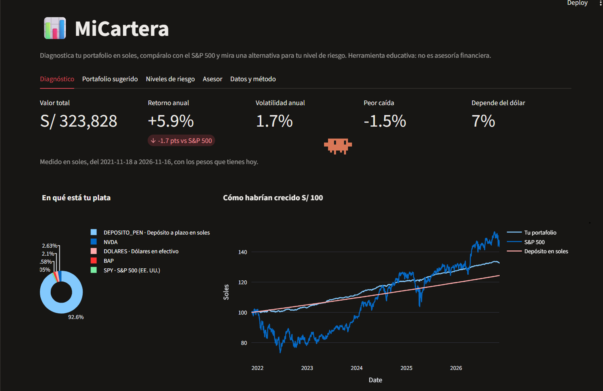
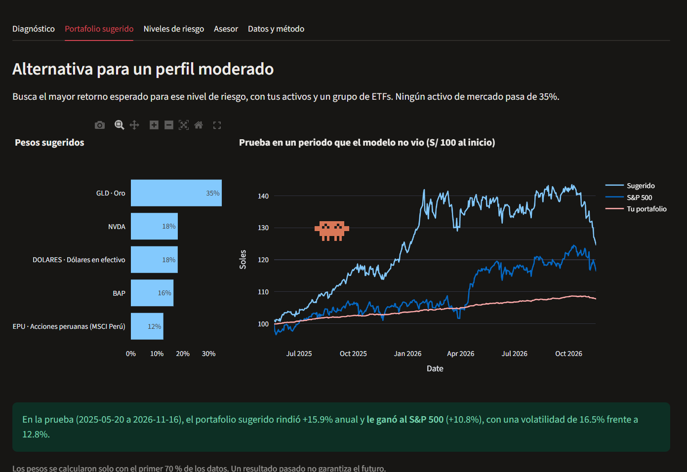
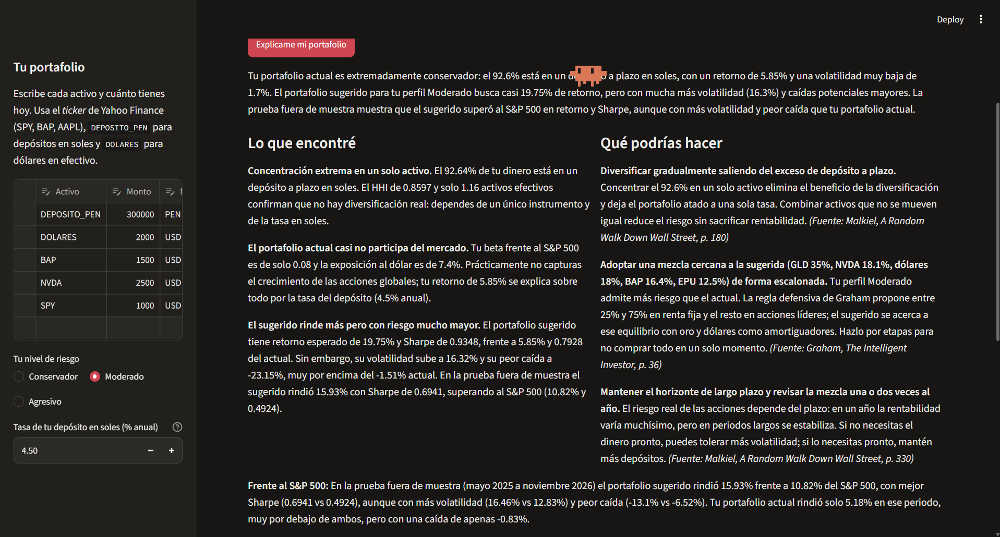
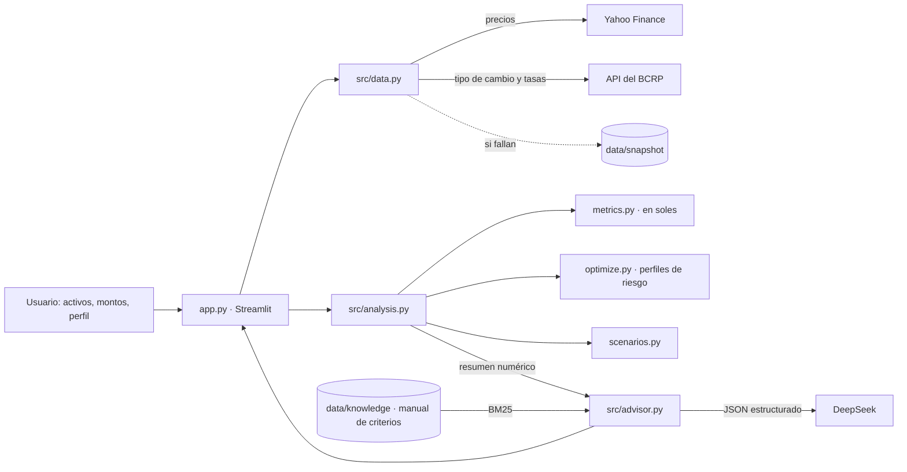

# MiCartera

**Hacemos diagnósticos de portafolio para inversionistas peruanos no expertos, mediante datos de mercado en vivo, un optimizador por nivel de riesgo y un asesor con LLM que se apoya en un manual de criterios de inversión.**

Herramienta educativa. No es asesoría financiera personalizada.

## 1. One-liner

Hacemos **diagnósticos de portafolio** para **inversionistas peruanos no expertos** mediante **datos en vivo (Yahoo Finance y BCRP), un optimizador por nivel de riesgo y un asesor con LLM y RAG**.

## 2. Founder

**Mauricio Huaquisto.** Estudiante de Finanzas en la Universidad del Pacífico, practicante en la mesa de inversiones de MAPFRE y encargado de prácticas de matemáticas.

Por qué yo: en la mesa de inversiones veo cómo se mide y se controla un portafolio institucional (retorno en moneda local, riesgo, comparación contra un índice), y como encargado de prácticas explico ideas cuantitativas a quien las ve por primera vez. MiCartera une las dos cosas: llevar ese análisis al inversionista que recién empieza, con finanzas, matemáticas y machine learning.

## 3. Problema

Quien empieza a invertir en el Perú suele tener la plata repartida: un depósito en soles, dólares en efectivo, alguna acción y un ETF comprado desde una app. Con eso no puede responder tres preguntas básicas:

- **¿Me está yendo bien?** Las apps muestran la ganancia de cada activo en su moneda, no la del conjunto en soles, y no la comparan con nada.
- **¿Cuánto riesgo llevo?** No sabe cuánto de su patrimonio depende del dólar ni cuánto podría caer en un mal año.
- **¿Qué cambiaría?** Un asesor financiero atiende patrimonios grandes; para montos pequeños la alternativa son videos y foros.

Hoy lo resuelve con una hoja de cálculo propia o no lo resuelve.

**Evidencia:** tres inversionistas de 21 años con perfiles distintos (conservador, mixto y activo) respondieron un cuestionario; las notas están en [docs/research/](docs/research/). Dos no comparan su resultado contra nada formal, dos tienen la plata repartida sin una vista del total, y el más activo no sabe cuándo está concentrado ni cuándo rebalancear. Los tres pagarían S/ 15 al mes, dos con condiciones: que se explique en simple y que entregue un análisis que no puedan hacer solos.

## 4. Solución e insight

El usuario escribe lo que tiene (activo, monto y moneda) y recibe:

1. **Diagnóstico en soles:** retorno, volatilidad, peor caída, concentración, correlación entre activos y dependencia del dólar, frente al S&P 500 y a un depósito.
2. **Portafolio sugerido** para su nivel de riesgo (conservador, moderado o agresivo), evaluado en un periodo que el optimizador no vio.
3. **Niveles de riesgo y escenarios:** su portafolio junto a los tres perfiles, y qué pasaría con una caída como la de 2022, un mercado −20 % o −35 %, o un dólar ±10 %.
4. **Asesor:** un LLM explica los números en español claro y cita el manual de criterios.

**Insight:** el inversionista peruano vive en soles pero invierte en dólares. Un portafolio que "sube" en dólares puede estar plano en soles; por eso todo se mide en soles con el tipo de cambio diario del BCRP. Y el LLM no calcula nada: los números salen de código probado, y el modelo solo los explica.

## 5. Why now

- **Acceso:** desde hace pocos años un peruano puede comprar acciones y ETFs de EE. UU. desde el celular con montos pequeños. Hay más inversionistas nuevos que asesores.
- **Costo:** explicar un portafolio con un LLM cuesta alrededor de US$ 0.0014, medido en este proyecto.
- **Datos abiertos:** el BCRP publica tipo de cambio y tasas por API, sin clave.

## 6. Demo

**Demo en vivo:** https://mi-cartera-m7hej9rb79m6dt58ym2jdo.streamlit.app/

**Video del demo:** [MiCartera en funcionamiento (Google Drive)](https://drive.google.com/drive/folders/1iaw1rurp9v1769OmkkP8NdUIx-SXG1eC?usp=sharing)

**Cómo correrlo**

```
python -m venv .venv
.venv\Scripts\activate
pip install -r requirements.txt
copy .env.example .env   # y pon tu DEEPSEEK_API_KEY
streamlit run app.py
```

Sin la clave, todo funciona menos la pestaña *Asesor*.

**Versión pública:** el Asesor usa un modelo de pago, así que está protegido con un código (`ADVISOR_CODE`, en `.env` o en los *secrets* del despliegue). Sin el código, la pestaña muestra una respuesta real guardada en `data/example_advice.json`, y el resto de la app funciona completo.

**Capturas**

| Diagnóstico en soles | Portafolio sugerido y prueba fuera de muestra |
|---|---|
|  |  |



**Arquitectura**



**Modelos y APIs, y por qué**

| Pieza | Elección | Por qué |
|---|---|---|
| Precios | Yahoo Finance (`yfinance`) | Gratis, sin clave, cubre acciones y ETFs de EE. UU. y ADR peruanos |
| Tipo de cambio y tasas | API del BCRP (`PD04640PD`, `PD12301MD`, `PN07816NM`) | Fuente oficial; permite medir todo en soles |
| LLM | DeepSeek `deepseek-flash`, modo JSON | Barato y suficiente para redactar a partir de números ya calculados |
| Recuperación | BM25 propio sobre el manual | Corre en un servidor gratuito sin descargar un modelo de embeddings |
| Optimizador | `scipy` (SLSQP) | Máximo retorno esperado con tope de volatilidad y de peso por activo |

Si Yahoo o el BCRP no responden, la app usa la copia de `data/snapshot/` y lo indica en la pestaña *Datos y método*.

## 7. Modelo de negocio

- **Quién paga:** el inversionista minorista, con una suscripción.
- **Precio:** S/ 15 al mes. El diagnóstico básico es gratis; el plan pagado incluye el portafolio sugerido, los escenarios y el asesor.
- **Costo por usuario:** una explicación del asesor cuesta US$ 0.0014 medidos (tarifa de horario pico). Con 20 explicaciones al mes son US$ 0.03, unos S/ 0.10. Los datos de mercado no tienen costo y el servidor es el plan gratuito de Streamlit Community Cloud.
- **Qué sigue:** alertas cuando el portafolio se aleja del perfil elegido, y carga de posiciones desde el estado de cuenta del bróker.

## 8. Herramientas del curso

| Herramienta | Sesión | Dónde está |
|---|---|---|
| APIs de datos (BCRP y Yahoo Finance) | 03 | [src/data.py](src/data.py) |
| LLM con salidas estructuradas | 08 | [src/advisor.py](src/advisor.py) |
| RAG: recuperación sobre el manual de criterios, con cita de documento y página | 08 | [src/knowledge.py](src/knowledge.py) |
| Dashboard | 05 | [app.py](app.py) |

Por qué estas: sin las APIs no hay diagnóstico en soles; sin la salida estructurada no se puede comprobar que cada cita del asesor corresponda a un fragmento entregado.

## 9. Qué hizo el agente

El código se escribió con Claude Code: los módulos de `src/`, la interfaz, las pruebas y este README. Las decisiones de producto son del founder: medir en soles, comparar contra el S&P 500, sugerir un portafolio por nivel de riesgo, agregar escenarios más allá de las crisis y construir una base de conocimiento a partir de bibliografía de inversiones.

## Base de conocimiento

El asesor se apoya en [data/knowledge/chunks.json](data/knowledge/chunks.json): 17 criterios de inversión redactados con palabras propias, cada uno con el libro y la página del PDF de donde sale. Los libros no se publican.

| Fuente | Temas |
|---|---|
| Malkiel, *A Random Walk Down Wall Street* | Diversificación, rebalanceo, fondos índice, plazo, aportes periódicos, exceso de confianza |
| Graham, *The Intelligent Investor* | Regla 25–75 entre renta fija y acciones, margen de seguridad |
| Gibson, *Asset Allocation* | Disciplina de rebalanceo |
| Schweser CFA 2025, *Portfolio Management* | Riesgo sistemático, ratio de Sharpe, VaR, asignación estratégica |
| Shiller, *Irrational Exuberance* | Valorización y retornos futuros |
| Kahneman, *Thinking, Fast and Slow* | Aversión a la pérdida y marco estrecho |

## Límites conocidos

- Se asume que los tickers cotizan en dólares.
- No incluye comisiones ni impuestos.
- Cinco años de historia no cubren todas las crisis; el escenario de −35 % se estima con la sensibilidad al S&P 500, no con datos de 2020.
- El portafolio sugerido se calcula con retornos pasados. Que haya superado al S&P 500 en la prueba no garantiza que lo haga en adelante.
- La recuperación es por palabras (BM25), no por significado.

## Estructura

| Carpeta | Qué contiene |
|---|---|
| `app.py` | Interfaz (Streamlit). Solo muestra; no calcula. |
| `src/` | Lógica: datos, métricas, optimizador, escenarios, base de conocimiento, asesor. |
| `scripts/` | Actualiza la copia local de datos. |
| `data/snapshot/` | Copia local de precios, tipo de cambio y tasas. |
| `data/knowledge/` | Manual de criterios de inversión que usa el asesor. |
| `conocimiento/` | PDF fuente (locales, no se suben). |
| `docs/research/` | Notas de conversaciones con usuarios. |
| `tests/` | Pruebas unitarias y de humo. |
